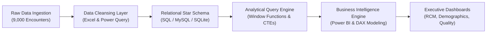
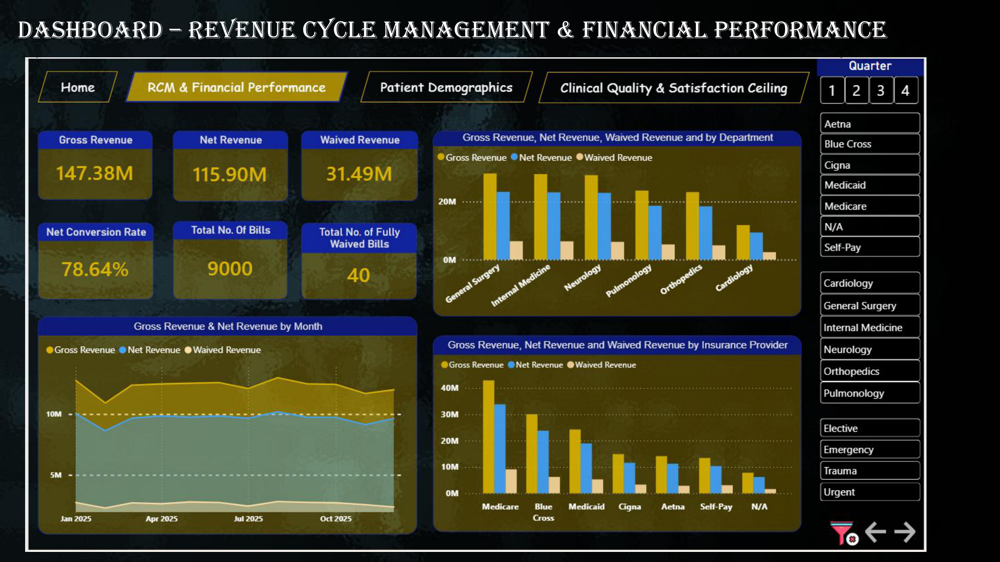
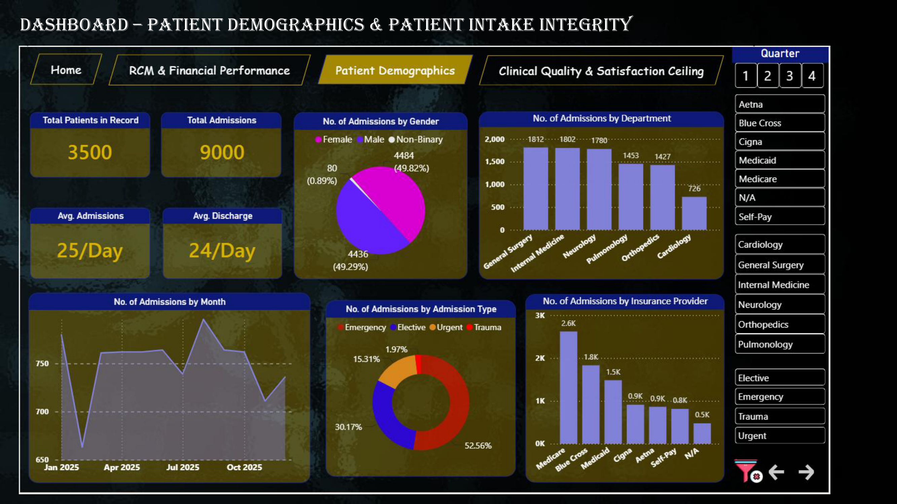
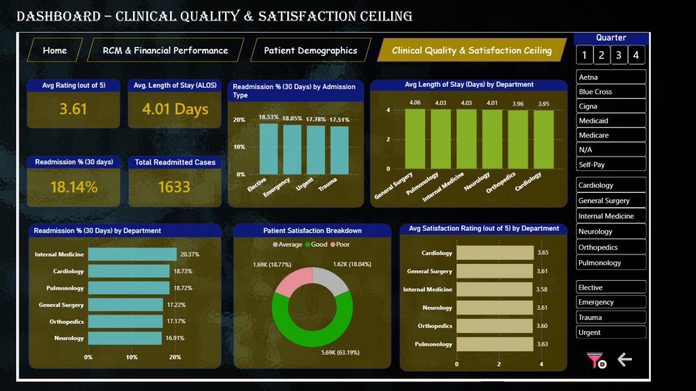

# Healthcare Operations Analytics Project
### End-to-End Enterprise Analytics Pipeline (Excel ➔ SQL ➔ Power BI)

**Tech Stack:** Microsoft Power BI & DAX | SQL (MySQL / SQLite) | Microsoft Excel & Power Query | Python

---

## 📌 Executive Summary

This repository delivers an end-to-end data analytics and business intelligence pipeline evaluating hospital operations, revenue cycle health, clinical staffing capacity, and patient readmission risks. Modeling **3,500 unique patient records** across **9,000 distinct inpatient encounters**, the project uncovers actionable financial leakage, capacity imbalances, and post-discharge care quality gaps.

```
┌────────────────────────┐      ┌────────────────────────┐      ┌────────────────────────┐
│   Gross Chargemaster   │      │   Net Realized Revenue │      │   30-Day Readmission   │
│        $147.38M        │ ───> │        $115.90M        │ ───> │         18.14%         │
│   (9,000 Encounters)   │      │   (78.6% Realization)  │      │   (Value-Based Risk)   │
└────────────────────────┘      └────────────────────────┘      └────────────────────────┘
```

---

## 🏗️ Data Architecture & Pipeline



### **1. Ingestion & Cleansing (Excel & Power Query)**
* **Deduplication & Hygiene:** Eliminated 150 corrupted duplicate rows; normalized string variations across payer names using `TRIM`, `CLEAN`, and `PROPER`.
* **Date Parsing & Engineering:** Standardized non-standard mixed date formats (`D/M/Y`, `M/D/Y`, `Y/M/D`) into ISO standard format (`YYYY-MM-DD`).
* **Median Imputation:** Substituted corrupted and missing age fields (e.g., `-1`, `999`) and missing satisfaction ratings with cohort median values.
* **Feature Engineering:** Calculated patient length of stay (`Stay_Days = Discharge_Date - Admission_Date`), contractual write-offs (`Waived_Amount = Total_Charges - Net_Paid`), and fiscal quarters (`Year_Quarter`).

### **2. Relational Modeling & Query Engine (SQL)**
* **Star Schema Implementation:** Normalized flat hospital intake records into a clean star schema with Primary/Foreign Key relational integrity.
* **Analytical Transformations:** Executed provider productivity indexing, readmission cohort tracking, and payer write-off auditing using Common Table Expressions (CTEs), Window Functions (`DENSE_RANK()`, `ROW_NUMBER()`), and conditional aggregations.
* **Automated Python DB Validation:** Provided a one-command SQLite pipeline (`scripts/load_and_test_db.py`) executing all 18 analytical queries with automated validation.

### **3. Business Intelligence Engine (Power BI & DAX)**
* **Dynamic DAX Modeling:** Formulated optimized measures for Net Conversion Efficiency, CMS Readmission Penalties, and Dynamic Admission/Discharge Velocity.
* **Interactive Executive Navigation:** Built a cohesive multi-page analytical dashboard with synchronized slicers and drill-downs.

---

## 📊 Interactive Dashboard Previews

### 1. Revenue Cycle Management (RCM) & Financial Performance
Audits realization rates across $147.38M in chargemaster billings, highlighting payer-level payment velocities and unallocated revenue write-offs.



---

### 2. Patient Demographics & Intake Integrity
Evaluates patient volume flows across medical specialties, age cohorts, and admission types to uncover service line demand imbalances.



---

### 3. Clinical Quality & Value-Based Readmission Risk
Maps the facility's 18.14% 30-day readmission risk profile and identifies length-of-stay thresholds that drive patient recidivism.



---

## 🔍 Key Business Insights

| Insight Domain | Discovery | Operational & Strategic Impact |
| :--- | :--- | :--- |
| **Registration Leakage** | **$1.60M in gross charges** categorized under missing insurance profiles (`"N/A"`). | Implemented mandatory insurance verification gates at intake to eliminate preventable write-offs. |
| **Capacity Headroom** | Cardiology carries only **4 patients/day per provider** vs. Surgery's **10+**. | Identified immediate headroom to scale Cardiology admissions 300% without adding physician headcount. |
| **Post-Discharge Care Gap** | Readmissions decline through Day 4, then **spike to 25.0% on Day 12**. | Pinpointed the critical need for a structured Transitional Care Management (TCM) call/follow-up protocol within 7–10 days post-discharge. |
| **Length of Stay Invariance** | Average Length of Stay (ALOS) is invariant at **4.01 days** across diagnoses. | Indicates standardized discharge protocols rather than clinical acuity-adjusted pathways. |

---

## 🗄️ Database Architecture (Star Schema)

```mermaid
flowchart TD
    subgraph Dim_Patients ["Dim_Patients (Dimension)"]
        direction TB
        P_PK["🔑 patient_id (PK)"]
        P_INFO["patient_name<br/>gender<br/>age<br/>insurance_provider"]
    end

    subgraph Fact_Admissions ["Fact_Admissions (Fact Table)"]
        direction TB
        A_PK["🔑 encounter_id (PK)"]
        A_FK["🔗 patient_id (FK)<br/>🔗 doctor_id (FK)"]
        A_DATES["admission_date<br/>discharge_date<br/>stay_days"]
        A_CLINICAL["admission_type<br/>primary_diagnosis<br/>patient_satisfaction<br/>readmission_30_days"]
        A_FINANCIAL["total_charges<br/>net_paid<br/>waived_amount"]
    end

    subgraph Dim_Doctors ["Dim_Doctors (Dimension)"]
        direction TB
        D_PK["🔑 doctor_id (PK)"]
        D_INFO["doctor_name<br/>specialty"]
    end

    Dim_Patients -->|1 : N (patient_id)| Fact_Admissions
    Dim_Doctors -->|1 : N (doctor_id)| Fact_Admissions
```

| Table Name | Schema Type | Primary Key | Foreign Keys | Key Metric / Business Attribute |
| :--- | :--- | :--- | :--- | :--- |
| **`Dim_Patients`** | Dimension | `patient_id` | *None* | Patient demographics, age cohort, primary insurance provider |
| **`Dim_Doctors`** | Dimension | `doctor_id` | *None* | Attending physician name, medical specialty department |
| **`Fact_Admissions`** | Fact | `encounter_id` | `patient_id`, `doctor_id` | Billed charges, collections, write-offs, stay duration, 30-day readmission |

---

## 📁 Repository Directory Structure

```text
Healthcare-Operations-Analytics-Project/
├── .gitignore                                   # Ignore rules for DB, temp files, and caches
├── README.md                                    # Project documentation & dashboard report
├── dashboard/
│   ├── Healthcare_Project_Dashboard.pbix        # Interactive Power BI dashboard file
│   ├── dax_measures.md                          # Full DAX formulas and measure definitions
│   └── screenshots/                             # High-resolution dashboard page renders
│       ├── 01_home_dashboard.png
│       ├── 02_rcm_financial_performance.png
│       ├── 03_patient_demographics.png
│       └── 04_clinical_quality_satisfaction.png
├── data/
│   ├── data_dictionary.md                       # Comprehensive field definitions & metadata
│   ├── raw/
│   │   ├── Raw_Data_Healthcare_Project.xlsx     # Unprocessed raw hospital intake sheet
│   │   ├── raw_dim_doctors.csv
│   │   ├── raw_dim_patients.csv
│   │   └── raw_fact_admissions.csv
│   └── processed/
│       ├── Cleaned_Data_Healthcare_Project.xlsx # Fully cleansed master Excel dataset
│       ├── dim_doctors.csv                      # Doctors dimension (50 rows)
│       ├── dim_patients.csv                     # Patients dimension (3,500 rows)
│       └── fact_admissions.csv                  # Inpatient encounters fact (9,000 rows)
├── reports/
│   └── Healthcare_Operations_Executive_Report.pdf # 40-page executive presentation
├── scripts/
│   └── load_and_test_db.py                      # Automated SQLite DB loader & query runner
└── sql/
    ├── 01_schema_setup.sql                      # Production DDL & table creation script
    └── 02_analytical_queries.sql                # 18 production analytical business queries
```

---

## ⚡ Quick Start: Running the Project Locally

### 1. Prerequisites
* Python 3.8+ with `pandas` and `openpyxl`
* MySQL 8.0+ or SQLite3 (or run via the included Python runner)
* Microsoft Power BI Desktop (to open `.pbix`)

### 2. Automated SQL Verification (1 Command)
Run the automated database build and query test suite:
```bash
python scripts/load_and_test_db.py
```
This script automatically:
1. Builds a relational database from the processed CSV datasets.
2. Ingests all 50 doctors, 3,500 patients, and 9,000 admission encounters.
3. Executes all 18 analytical queries from `sql/02_analytical_queries.sql` and prints execution benchmarks.

### 3. Native MySQL Setup
If executing in MySQL Workbench or CLI:
```bash
mysql -u your_username -p < sql/01_schema_setup.sql
mysql -u your_username -p healthcare_project < sql/02_analytical_queries.sql
```

---

## 📐 Documented DAX Calculations

Key measures implemented in Power BI (detailed in `dashboard/dax_measures.md`):

* **Net Realized Conversion Rate (%):**
  $$\text{Net Conversion Rate} = \frac{\sum(\text{Net Paid})}{\sum(\text{Total Charges})}$$
* **CMS 30-Day Readmission Exposure Rate (%):**
  $$\text{Readmission Rate} = \frac{\text{CALCULATE}(\text{COUNTROWS}(\text{Admissions}),\ \text{Readmission} = \text{"Yes"})}{\text{COUNTROWS}(\text{Admissions})}$$
* **Average Length of Stay (ALOS):**
  $$\text{ALOS} = \text{AVERAGE}(\text{Fact\_Admissions}[\text{Stay\_Days}])$$

---

## 👤 Author
**Anwesha Gouda**  
*Healthcare Operations & Data Analytics Project.*
